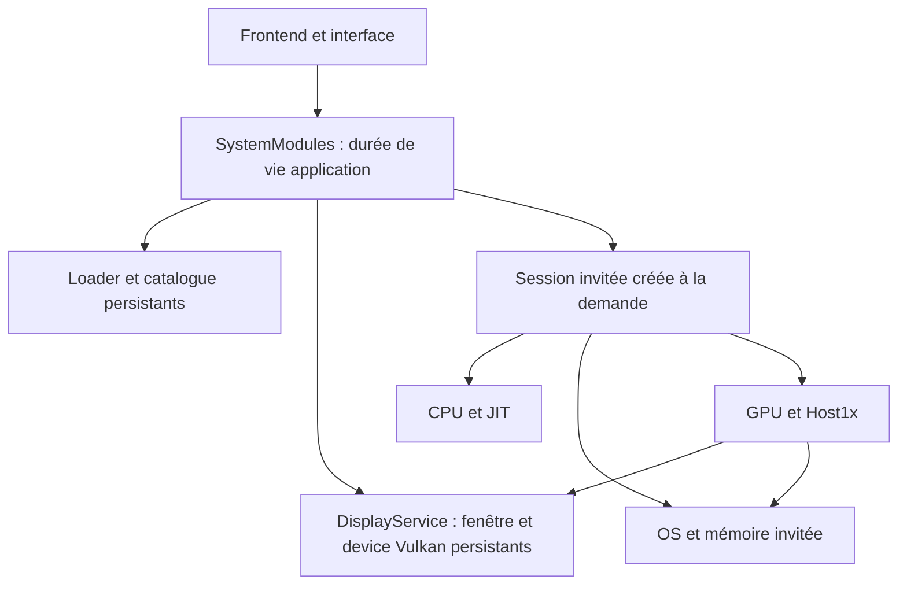

# Revue de l'architecture NXEmu — 27 octobre 2026

## Périmètre et provenance

Branche : `fix/architecture-async-presentation`, depuis le `master` local
`db36580c` (arbre initial propre). Aucun déplacement de `master`, aucune publication distante.

Entrée : `NXEmu_Architecture_Bundle_Final_Rebase_Main_2026-10-27.zip`.
SHA-256 du patch fourni :
`5b714cab8995f87beb6d423183b2142320e624f582b606cd06fb578b99c28e2e`.
Le patch s'applique sans conflit. Les documents du bundle ont été utilisés comme
contexte de conception et comme déclarations de leur auteur, à vérifier.

Cette branche prépare les fondations de la présentation asynchrone. Elle
n'implémente pas encore de thread de présentation ni de nouvelle politique de compilation
asynchrone des shaders.

## Architecture conservée

- Les DLL, le catalogue du loader et le service d'affichage appartiennent à l'application.
- Le CPU/JIT, l'OS invité, Host1x et le GPU invité appartiennent à une session de jeu.
- L'interface et le device Vulkan survivent à l'arrêt d'un jeu.
- Les services d'entrée et de profils exposent des copies appartenant au frontend.
- Les tâches de catalogue et de firmware sont terminées avant toute transition qui
  invaliderait leurs emprunts au loader.
- Le processus et le GPU doivent avoir fini leur démarrage avant toute exécution CPU invitée.
- L'arrêt draine le travail, libère GPU/Host1x avant la mémoire OS, puis réinitialise
  les données du jeu dans le loader. Le frontend reste disponible.



## Corrections apportées après application du bundle

| Constat | Correction |
|---|---|
| Des méthodes virtuelles sont insérées sans changement de version ABI. | Loader `0x0138`, vidéo `0x0128`, OS `0x0128`. L'OS doit aussi changer de version : il consomme les vtables et le protocole de lancement modifiés. Le CPU ne consomme pas ces interfaces modifiées. Le test refuse les versions précédentes. |
| MSVC refuse la déclaration `struct IOperatingSystem` précédant sa définition `__interface`. | Déclaration préalable via `nxinterface` dans le service de profils. |
| La désinscription ignore tout drainage dès qu'elle est appelée depuis n'importe quel callback. | Suivi de la registration réellement exécutée sur la pile courante. Retirer un autre abonné attend ses appels actifs. |
| Une deuxième désinscription peut ne plus trouver une registration déjà retirée mais encore active. | Les registrations retirées restent accessibles pendant leur drainage ; leur suppression finale intervient après le dernier appel. |
| L'événement de pause est consommable par un seul appelant et peut conserver un signal ancien. | Attente sur un prédicat protégé par mutex, notification de tous les appelants, annulation prise en compte. |
| Deux appels peuvent acquérir la même porte de lancement. | Refus d'une seconde acquisition pendant un lancement en cours. |
| Une notification peut lire l'état avant d'attendre le verrou de transition et utiliser ensuite une valeur périmée. | Lecture de l'état après acquisition du verrou. |
| Un échec avec exception pendant la création d'une session laisse un état partiel. | Retour d'échec avec nettoyage des objets déjà créés. |
| La destruction de l'OS dépend entièrement du bon appel préalable au protocole d'arrêt. | L'OS joint son thread de contrôle avant de libérer son processus. |
| Le protocole pair/impair de progression suppose un seul rédacteur. | Sérialisation explicite des publications de progression provenant des workers. |
| Un échec de récupération d'une liste de mappings peut être traité comme une liste vide. | Refus de la copie partielle, sans appliquer des mappings incomplets. |
| Les tests fournis sont externes au build et utilisent `assert`, désactivé en Release. | Intégration CTest ; assertions actives pour les tests, y compris les tests existants. |
| Le test NACP lie des classes C++ internes à une DLL Windows qui ne les exporte pas. | Compilation des sources de parsing nécessaires dans le test Windows. |

Le registre de callbacks évite aussi son verrou et sa recherche lorsqu'aucun abonné
n'est présent. Les réveils de drainage ne se produisent que pour une registration retirée.

Contrat conservé : une auto-désinscription annule les appels futurs sans attendre
sa propre pile. Le propriétaire doit survivre aux autres invocations concurrentes.
Les callbacks ne doivent pas se désinscrire mutuellement dans un cycle entre threads.
Les paramètres persistants, le JSON et les chaînes empruntées gardent leur contrat
de propriété existant ; rendre les états runtime atomiques ne rend pas tous les
paramètres de l'émulateur arbitrairement accessibles en écriture concurrente.

## Validation

Environnement : Windows x64, Visual Studio 2022/MSVC 19.44, Release,
Ryzen 7 9800X3D, GPU Vulkan effectivement sélectionné NVIDIA GeForce RTX 5070 Ti.

- Compilation CMake complète de l'application, des quatre DLL et des tests.
- 9 tests CTest : cycle de session existant, SPIR-V, métadonnées NACP,
  états runtime, drainage des callbacks, stockage hors jeu, porte de lancement,
  cycle des vraies DLL et cycle du véritable affichage Vulkan.
- 720 scénarios exécutent le **vrai** `EmuThread` avec des dépendances CPU/GPU
  contrôlées : succès, échec, arrêt avant lancement, arrêt pendant le lancement,
  pause sur échec et pauses concurrentes.
- Progression : 180 000 publications avec lecture concurrente et vérification
  des snapshots ; enregistrement/désinscription pendant les notifications.
- Callback actif pendant destruction, désinscriptions simultanées,
  désinscription depuis un autre callback et exception d'un abonné.
- Les tests de DLL font huit cycles et vérifient l'identité des objets host,
  l'arrêt répété et la reprise après chargement partiel échoué.
- Le test Vulkan utilise une fenêtre native invisible : écriture d'images de
  l'interface, soumissions et présentation, création/arrêt du GPU invité,
  puis vérification que les handles instance/device sont identiques après chaque session.
- Les données des tests de stockage et d'intégration sont isolées dans des
  répertoires temporaires ; aucun jeu ou profil utilisateur n'est nécessaire.

Un premier essai synthétique Vulkan sollicitait un cache par titre sans avoir
chargé de processus. La pile montrait `OSManager::GetProgramId`. Le test a été
corrigé pour désactiver ce cache pendant ce scénario d'annulation avant lancement.
Il ne prétend donc pas couvrir le chargement du cache d'un vrai titre.

## Mesures

Microbenchmarks exécutés successivement, après compilation, sur `master`, le
bundle exact et la version revue. Neuf répétitions, deux millions d'itérations
par opération et répétition, ordre alterné. Médianes en ns/itération :

| Opération | master | bundle | version revue |
|---|---:|---:|---:|
| Lecture de deux états runtime | 77,909 | 14,808 | 12,697 |
| Écriture, aucun abonné dans le registre | 111,854 | 54,265 | 7,742 |
| Écriture, abonné sur un autre paramètre | 111,773 | 54,103 | 53,209 |
| Écriture, un callback actif | 117,863 | 112,482 | 114,511 |

La lecture est environ 6,1 fois moins coûteuse que dans `master` pour ce cas.
Le cas sans abonné est synthétique : l'application réelle garde plusieurs abonnés
et ne bénéficie pas nécessairement de cette absence globale. Avec un callback
actif, les écarts sont faibles ; la version revue ajoute des garanties de durée
de vie, sans gain significatif revendiqué pour ce cas.

Données brutes : [CSV des microbenchmarks](benchmarks/architecture-settings-2026-10-27.csv).
Ces temps ne sont pas des FPS, des frametimes GPU ou un débit de compilation shader.

Un passage du test de DLL sans affichage a mesuré 18,1 ms pour les modules host,
87,5 ms de création invitée en moyenne sur huit cycles, et environ 11,1 MiB de
mémoire privée host contre 99,3 MiB après la première création invitée.
Ces valeurs illustrent le travail différé, sans constituer un A/B du temps de
démarrage complet de l'interface : elles excluent son rendu Vulkan et un jeu chargé.

## Reproduction

```powershell
cmake --preset windows-x64 -DNXEMU_BUILD_TESTS=ON -DNXEMU_TEST_VULKAN_DISPLAY=ON
cmake --build build/windows-x64 --config Release --parallel 4
ctest --test-dir build/windows-x64 -C Release --output-on-failure

# Le test GPU est optionnel ; les tests ordinaires ne nécessitent pas de GPU.
ctest --test-dir build/windows-x64 -C Release -L unit --output-on-failure

# BundlePatch est le fichier .patch extrait du ZIP fourni.
./tools/architecture/benchmark_settings.ps1 -BaseRef db36580c -BundlePatch <chemin-du-patch>
```

## Limites et suite de la présentation asynchrone

Suivi après test réel : [régression 20XX → Mario Odyssey et correction du registre de fichiers](odyssey-startup-regression-2026-10-27.md).
Les limites ci-dessous décrivent la validation initiale, avant ce suivi.

Pas de benchmark FPS en jeu, de test visuel de jeux, de chargement réel de cache
shader, de validation Vulkan par couche, ni de build macOS/Linux/Android exécuté
pendant cette revue. Les tests Windows ne constituent pas un passage ASan/TSan/UBSan.
Le test Vulkan vérifie le cycle de vie et les soumissions, pas le résultat pixel
par pixel d'une image de jeu.

Le frontend garde le comportement du bundle : édition clavier des contrôles sans
OS invité ; les périphériques physiques sont énumérés mais leur mapping complet
reste lié au backend invité. Les mutations de profils et l'énumération audio peuvent
créer temporairement une session utilitaire. Ce sont des étapes intermédiaires
avant l'extraction complète des services host.

La future présentation asynchrone devra définir explicitement la propriété des
frames entre producteurs et présentateur, borner la file et sa politique de rejet,
attendre les fence/timeline avant recyclage, et drainer le présentateur avant la
destruction des images invitées. Elle devra aussi gérer resize, changement de
surface et arrêt pendant une présentation. La persistance du device seule ne
garantit pas ces propriétés. Une session de jeux réels avec caches froids/chauds,
mesures de frametimes et validation Vulkan reste nécessaire pour cette étape.
